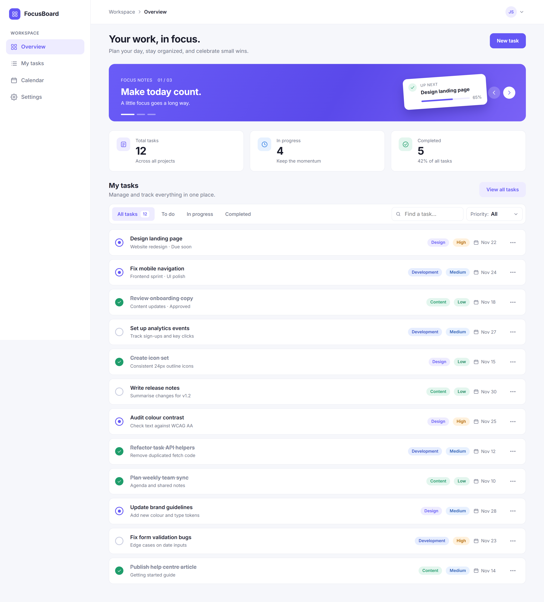
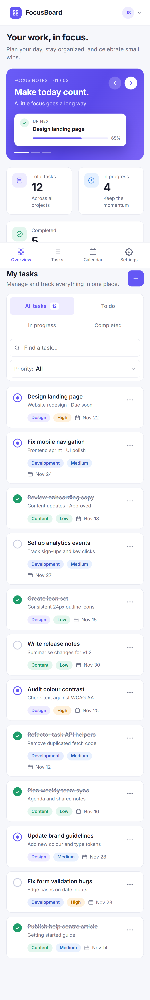

# FocusBoard

A responsive, single-user task dashboard built from the FocusBoard Figma reference.
Frontend only - no backend. Data is stored in the browser (`localStorage`).

- **Live URL:** https://focusboard-eta.vercel.app/ 
- **GitHub:** https://github.com/siripuramdeekshitha/focusboard-

## Screenshots

| Desktop (1440px) | Mobile (390px) |
| --- | --- |
|  |  |

## Run locally

```bash
npm install
npm run dev      # http://localhost:5173
npm run build    # production build in /dist
```

## Features

- Create, edit and delete tasks (delete asks for confirmation)
- Required-title validation with an inline, accessible error message
- Status: To do / In progress / Completed - change from the row menu or tick the circle
- Case-insensitive title search + status tabs + priority filter, all working together
- Stats (total, in progress, completed, completion %) are calculated from the task data
- Focus Notes carousel: 3 slides, previous/next buttons, clickable indicators, wraps around
- Tasks persist in `localStorage`; sample data is only used on the very first visit
- Responsive: desktop sidebar, mobile bottom navigation, stacked task cards, full-width form fields

## State management choice

I used **React Context + `useReducer`** (`src/context/TaskContext.jsx`).

- The task list is the single source of truth. Components never keep their own copy of tasks.
- All changes go through a pure reducer (`ADD`, `UPDATE`, `DELETE`, `SET_STATUS`) that returns new arrays, so state is never mutated directly.
- Stats and the filtered list are **derived** from `tasks` with `useMemo`, so they always match the current data.
- Small UI state (search text, tab, priority, open dialogs, carousel index) lives in the components that use it with `useState`.
- A library like Redux or Zustand would be more than this app needs.

## Folder structure

```
src/
  components/   Sidebar, Header, FocusNotesCarousel, StatsCards, TaskToolbar, TaskList, TaskRow, TaskFormModal, ConfirmDialog
  context/      TaskContext.jsx (reducer + localStorage)
  data/         sampleTasks.js, focusNotes.js
  utils/        tasks.js (stats, filtering, date formatting)
```

## Accessibility

Semantic landmarks (`header`, `nav`, `main`, `aside`), labelled form controls, `aria-pressed` on filter tabs,
native `<dialog>` for focus trapping and Esc to close, visible focus rings, `aria-live` on the carousel text,
and reduced-motion support.

## Limitations / placeholders

- **Calendar** and **Settings** navigation items, the account menu and the avatar are visual placeholders.
- Focus Notes slide content is static (as in Figma); the floating card is not linked to real tasks.
- The Figma has three status tabs; I added a **To do** tab so every status can be filtered.
- Data is per browser - there is no sync between devices.
